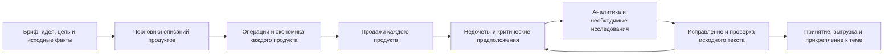

---
---

# Модель проекта

У Brief.md, Strategy.md, Brand.md, Design.md и Products.md есть собственные рабочие переписки, черновики и правки. Каждый продукт содержит свои разделы. Пользователь отвечает агенту в переписке нужного файла и проверяет формулировку перед сохранением. В общем рабочем пространстве есть отдельные темы с выбранными сохранёнными документами в качестве базы знаний. Документы можно свободно выгружать.

Обзор показывает исходные тексты без второй редактируемой копии. Предложение и экономика продукта редактируются в его описании; обзор проекта отображает их.

## Этапы проекта

### Бриф

Опишите проект, текущую ситуацию, продукты, переданные материалы, ожидаемый результат, границы, ограничения и ответственного за решения. Неизвестные факты остаются открытыми.

### Продукты

У каждого продукта отдельное описание. Продукт открывает собственные разделы:

| Раздел продукта              | Содержание                                                                                                 |
| ---------------------------- | ---------------------------------------------------------------------------------------------------------- |
| **Продукт**                  | Клиент, проблема, предложение, ценность, альтернативы и условия.                                           |
| **Операции и экономика**     | Выполнение, выручка, ресурсы, действия, партнёры, расходы и финансирование этого продукта.                 |
| **Продажи**                  | Знакомство, оценка, покупка, получение, использование, поддержка и продолжение.                            |
| **Продвижение**              | Текстовое описание публичной подачи, включая сайт, креативы и презентацию, где они нужны.                  |
| **Аналитика и исследования** | Измерения, наблюдения, вопросы и доказательства для проверки предположений; исследования по необходимости. |

Общие ресурсы имеют одинаковый идентификатор в использующих их продуктах; каждый продукт указывает свою долю. Представление экономики не создаёт промежуточную общую модель.

### Стратегия

Опишите приоритетные аудитории, роли продуктов, позиционирование, пути клиентов, каналы и критерии успеха. Фиксируйте устройство проекта, а не историю принятия решений.

### Бренд

Опишите смысл, обещание, допустимые утверждения, доказательства, голос, возражения и призывы к действию.

### Дизайн

Запишите визуальное направление, имеющиеся ресурсы, принципы интерфейса и ограничения. Текст первого выпуска не генерирует айдентику и не собирает лендинг.

## Цикл разработки продукта

AI-агент находит недочёты для исправления пользователем. Исследование записывает доказательства с источниками, где они есть, и вопросы, где их нет. Принятие фиксирует проверку текста, а не жизнеспособность бизнеса.

## Состояния сведений

- **accepted — принято:** пользователь проверил формулировку;
- **proposal — предложение:** черновик ожидает проверки;
- **unknown — неизвестно:** материал и пользователь не установили нужный факт;
- **conflict — противоречие:** исходные утверждения дают несовместимые ответы.

Метки относятся к исходному описанию. Предлагаемое изменение проходит проверку в этом тексте перед заменой принятой формулировки.

## Продолжение работы в чате

Пользователь создаёт тему в общем рабочем пространстве и выбирает сохранённые проверенные документы. У темы своя переписка; файлы помогают оценить идею, сравнить варианты или подготовить текст. Изменение документа возвращается в переписку его файла для проверки.

Тема может начинаться с одного проверенного файла, пока в других разделах остаются вопросы. Последняя проверенная версия документа доступна как контекст темы во время редактирования нового черновика и меняется после проверки и сохранения. Документы можно свободно выгружать и использовать вне AI Chat. Недостающий факт остаётся вопросом; его не придумывают ради законченного ответа.

Генерация лендинга и платное развёртывание на сервере относятся к будущим возможностям вне первого выпуска. Цель будущей страницы — первые обращения и проверка гипотезы; эти результаты не гарантированы.
