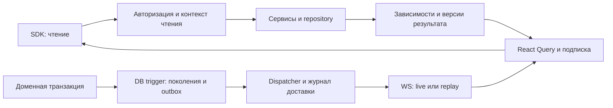

# План автоматического обновления зависимых запросов

## Результат внедрения

Запрос получает зависимости из фактически выполненных чтений моделей и связей. Изменение данных обновляет только зависящие от него запросы, независимо от Subject и URL, через который сделана запись. Два участника одного треда получают новые и отредактированные сообщения. Несвязанные проекты, настройки и корзины сохраняют свои данные и состояние.

Стандартная новая модель подключается через существующие Configuration, Table, repository, SDK и генератор. Дополнительный список связей для кэша отсутствует. Нестандартные SQL-чтения используют общий адаптер с известной областью таблиц. Фреймворк сохраняет React Query владельцем данных, WebSocket — каналом уведомлений, а `globalActionsStore` — журналом событий для диагностики.

Реализация включает сохраняемый журнал изменений, восстановление после разрыва соединения, проверку версий при конкурирующих чтениях и записях, сохранение черновиков и исправление прокрутки чата.

## Проверенная исходная база

| Участок             | Текущее поведение и источник                                                                                                                                                                                                                   |
| ------------------- | ---------------------------------------------------------------------------------------------------------------------------------------------------------------------------------------------------------------------------------------------- |
| Общий repository    | `libs/shared/backend/api/src/lib/repository/database/index.ts`: известны Table, select/insert schemas, фильтры и Configuration. Здесь уже сосредоточены find/count/findByField и записи.                                                       |
| Идентичность модели | `libs/shared/backend/api/src/lib/configuration/index.ts`: `repository.seed.module/name/type` и Table позволяют получить владельца физической таблицы без повторного каталога бизнес-связей. `seed.active` не определяет участие в consistency. |
| События записей     | `libs/shared/backend/api/src/lib/mutation-effects/index.ts`: publisher вызывает инвалидацию, Next tags, затем WebSocket. `apps/api/app.ts:169` передаёт его отдельными setter в Knowledge и CRM.                                               |
| HTTP-кэш            | `libs/middlewares/src/lib/http-cache`: поколения путей/topics и исключения. Текущий ключ ответа не разделяет пользователей; приватные исключения необходимы до изменения границы авторизации.                                                  |
| Клиент              | `libs/shared/frontend/client/api/src/lib/factory/index.ts`: общие mutations уже патчат списки; subscription сопоставляет topics и использует route fallback. Широкие topics затрагивают несколько ресурсов.                                    |
| Транспорт           | `libs/shared/backend/utils/src/lib/websocket-manager/index.ts`: клиенты хранятся в памяти процесса. `apps/api/app.ts:134` открывает общий WS без протокола подписки, курсора и replay.                                                         |
| Chat                | Message SDK использует URL без params в queryKey и общий topic `social.messages`. Reader сообщений включает `refetchInterval: 5000`.                                                                                                           |
| Прокрутка           | Production `social/message/.../list-ai-chat/ClientComponent.tsx:183` и Studio `social/message/singlepage/list-ai-chat/Component.tsx` сбрасывают followingLatest и scrollTop при изменении последнего сообщения.                                |
| Состояние UI        | `libs/shared/frontend/components/src/lib/singlepage/find/client.tsx:22`: фоновая загрузка без keepDataWhileFetching размонтирует содержимое. Читатели AI-чата в основном уже используют isPending.                                             |
| Оптимизации         | Строки нового AI-чата используют memo и ID-ключи. В диагностике structural sharing сохранил неизменившиеся строки после JSON-refetch.                                                                                                          |

Диагностика исходного состояния: 6 проверок компонентов/React Query в `/private/tmp/sps-cache-render-diagnostics-20261016`; 17 тестов Knowledge service и 1 тест reader-refresh прошли. Временные диагностические файлы не являются постоянной проверкой проекта: нужные сценарии входят в этапы ниже. Предыдущие исследования ISSUE-195 объясняют происхождение механизма; их утверждения о старых задержках, порядке middleware и отсутствии cache patches не описывают текущий HEAD.

## Архитектурные решения

### Чтения учитываются по выполнению

Контекст чтения на AsyncLocalStorage собирает обращения вложенных сервисов в рамках одного запроса. Каждый repository регистрирует зависимость до получения результата, включая пустую выборку, отсутствующий ID и count. Кэшированный внутренний результат возвращает свои сохранённые зависимости родительскому чтению.

Идентичность зависимости — физический ресурс и область его данных. Идентичность кэшированного ответа дополнительно содержит операцию, все параметры, контекст доступа и версию протокола. Например, два Subject имеют разные ключи ответов messages, но общую зависимость от `threads-to-messages` с `threadId=T`.

Движок не ищет все пути Subject → Message. При реальном чтении он уже видит запрос связи по Thread и последующее чтение Message. Связь остаётся обычной моделью relation со своими колонками.

### Изменения фиксируются в той же PostgreSQL-транзакции

Источник истины для записей — генерируемые PostgreSQL-триггеры на таблицах моделей и relations. Общая функция фиксирует INSERT/UPDATE/DELETE, old/new идентичность и области, меняет поколения зависимостей и добавляет запись в transactional outbox. Для TRUNCATE применяется отдельный statement trigger с инвалидированием коллекции.

Триггер покрывает также прямой SQL и FK-cascade, которые wrapper сервиса не видит. Он выполняет только технический учёт, без RBAC, отправки сообщений, анализа файлов и вызовов доменных сервисов. Триггер и исходная запись откатываются вместе; каскадные изменения вызывают триггеры затронутых таблиц. Это соответствует [контракту PostgreSQL](https://www.postgresql.org/docs/current/trigger-definition.html).

Схемы журнала и поколений принадлежат существующему `libs/providers/db`, в PostgreSQL schema `sps_consistency`. Общие API-адаптеры используют нейтральные интерфейсы. Новых бизнес-модулей и shared-пакетов не требуется. Инфраструктурные таблицы не попадают в общий REST CRUD, dump/seed пользовательских моделей и собственный захват изменений.

### Кэш и события имеют разные гарантии

- PostgreSQL хранит авторитетные поколения и outbox. Они меняются атомарно с данными.
- Redis хранит удаляемые кэшированные ответы и индексы зависимостей. Потеря Redis вызывает cache miss или повторную регистрацию подписок.
- Dispatcher после commit обрабатывает outbox, инвалидирует зарегистрированные Next tags и создаёт сохраняемую запись доставки. Повторы допустимы и идемпотентны.
- Каждый API-процесс читает журнал доставки своим курсором и уведомляет собственные WS-соединения. Одна competing consumer group на все API-процессы здесь непригодна: событие нужно каждому процессу с подходящими клиентами.
- PostgreSQL LISTEN/NOTIFY будит читателей; периодическое чтение журнала восстанавливает пропущенные сигналы. [NOTIFY привязан к commit](https://www.postgresql.org/docs/current/sql-notify.html), но историю хранит таблица журнала. [Redis Pub/Sub](https://redis.io/docs/latest/develop/pubsub/) может быть дополнительным сигналом пробуждения с at-most-once доставкой.
- Браузер получает только разрешённые уведомления о версиях, затем загружает данные своим авторизованным SDK. Содержимое сообщений, документов и old/new rows в WS отсутствует.

### Точность имеет безопасную границу

Первый выпуск поддерживает ID, eq и inArray над типами с проверенной нормализацией, а также области простых AND/OR. Например, AND с `threadId=T` и дополнительным текстовым условием может безопасно зависеть от всей области T. OR объединяет области всех ветвей; ветвь без ограничивающей области расширяет зависимость до коллекции.

Для range, NOT, произвольных выражений, неподдерживаемых типов и слишком большого набора зависимостей используется поколение соответствующей коллекции. Это может дать лишний refetch, но не пропуск обновления. Расширение набора операторов требует проверки эквивалентности с SQL-семантикой. Фильтры, колонки и связи не описываются заново.

### Один цикл обновления

Для нового Message транзакция создаёт запись и relation с `threadId=T`. Trigger изменяет поколения Message и области relation для T. Два ранее выполненных чтения участников зависят от этой области и получают уведомление; их разные Subject-префиксы значения не имеют. При правке существующего Message обновляется зависимость его ID. Если операция меняет ещё счётчик или preview, обновляются и читавшие их запросы. Профили, настройки и корзины обновляются только при изменении собственных зависимостей.

## Гарантии и пределы

1. После commit изменение существует в outbox; rollback не оставляет события и новых поколений.
2. API cache hit допустим только после проверки контекста доступа и актуальных поколений. Ответ старого поколения может храниться до TTL, но не выдаётся как актуальный. Next ISR имеет отдельную eventual-гарантию, описанную в этапе 4.
3. Уведомление о новой версии становится доступным после подготовки серверных кэшей. SDK не считает старый ответ достаточным подтверждением этой версии.
4. Доставка at-least-once: eventId, deliverySequence и версии делают повторы безопасными. Гарантия exactly-once для клиента не заявляется.
5. При доступных PostgreSQL и API изменения доставляются подписчикам; после разрыва выполняется replay или явная resync. При недоступном API UI показывает состояние синхронизации и сохраняет введённый текст.
6. Приватный ответ и право подписки разделяются по контексту доступа. Совпадение зависимости не разрешает читать чужие данные.
7. Только фактически зарегистрированные чтения участвуют в точной инвалидации. Неучтённый путь не получает доступ к долгому кэшированию; он остаётся no-store и виден в проверках покрытия.
8. Учёт зависимостей не обеспечивает атомарность нескольких самостоятельных HTTP-записей. Message со связями и операция корзины получают отдельные короткие доменные транзакции.

## Размещение изменений

Каталоги ниже уже имеют соответствующий вид файлов. Новые файлы остаются внутри существующих пакетов; многофайловая реализация занимает одну папку со входом index.ts.

| Владелец               | Каталог и изменения                                                                                                                                                                                                                                                    |
| ---------------------- | ---------------------------------------------------------------------------------------------------------------------------------------------------------------------------------------------------------------------------------------------------------------------- |
| Общие типы и константы | `libs/shared/utils/src/lib/types`, `constants`: версия протокола, сериализуемые descriptor/event/cursor types, пределы размера. Pure codecs размещаются в utils рядом с существующими topics/routes.                                                                   |
| Контекст и repository  | `libs/shared/backend/api/src/lib/repository/database`, `service`, `configuration`, `query-builder`: operation context, scoped DB resolution, фиксация чтений. Общие API-boundary helpers находятся в этом API-пакете.                                                  |
| Durable storage        | `libs/providers/db/src/lib/drizzle/schema.ts`, `config.ts`, `migrate.ts` и генерируемые migrations: outbox, поколения, журнал доставки и checkpoint dispatcher. Операции провайдера находятся в существующем пакете providers-db.                                      |
| Runtime                | `libs/shared/backend/api/src/lib/mutation-effects`: общий runtime/dispatcher с внедрёнными DB/KV/Next/transport ports. Общая функция приложения создаёт runtime один раз, без доменных setter.                                                                         |
| API boundaries         | `libs/middlewares/src/lib/http-cache`, `revalidation`: response metadata, проверки версий, compatibility. `apps/api/app.ts` и `server.ts`: публичная композиция runtime и WS. Отдельный entrypoint worker соседствует с server.ts; доменная логика туда не переезжает. |
| SDK transport          | `libs/shared/frontend/api/src/lib/actions` и `libs/shared/utils/src/lib/response-pipe.ts`: чтение метаданных без изменения публичного T/T[] результата. Server/client factories подключают один механизм.                                                              |
| Клиент                 | `libs/shared/frontend/client/api/src/lib/factory`, `cache`, `libs/shared/frontend/components`: query metadata, подписки, coalescing, patches, background states.                                                                                                       |
| Host realtime          | `apps/host/src/components/revalidation`: один WS-клиент с subscribe/replay/heartbeat. Данные сущностей остаются в React Query.                                                                                                                                         |
| Генераторы и проверки  | `tools/plugins/sps-generator-plugin/src/coder/root/libs/modules`, `tools/agents`, `tools/testing`, `apps/api/specs`: генерация покрытия и постоянные проверки.                                                                                                         |
| UI                     | Существующие варианты `apps/studio/modules/social/message`, `social/thread`, RBAC Subject и соответствующие варианты `libs/modules`. Публичные props — в interface.ts, варианты — в registry владельца.                                                                |

## Этап 0. Зафиксировать проверки и бюджет изменений

**Изменения:** перенести диагностические сценарии в owning test suites; добавить поддерживаемый сценарий в `apps/api/specs` и средства замера в `tools/testing`. Сохранить исходный отчёт для одного и того же набора данных и build mode.

- Два Subject, разные Profile, общий Chat/Thread; третий участник с другим Chat. Минимум два API-процесса.
- Отдельные замеры create/edit/delete, Knowledge attachment/index completion, cart quantity/price и навигации между тредами.
- Считать HTTP-запросы по queryKey, invalidations, commits React Profiler, renders строк, mount/unmount composer, сохранность draft/selection/scroll anchor.
- Считать DB queries/latency, lock wait, event lag, outbox backlog, metadata bytes и память индекса. Контент документов, credentials и полные токены не логировать.

**Приёмка:** тест воспроизводит старый скачок истории и потерю состояния общего find; benchmark воспроизводим. Исходный отчёт не выдаёт dev StrictMode commits за production performance.

## Этап 1. Каталог ресурсов и протокол

**Где:** Configuration/Table, shared utils types/constants, существующий generator и API/SDK contract tests.

1. Получать resource identity из effective repository Configuration и реальной Table. Startup overrides, relations, custom physical names и composite primary keys участвуют в каталоге. Конфликт двух владельцев одной таблицы — ошибка проверки.
2. Формировать каталог автоматически из существующих входов генерации/конфигурации. Проверять его полноту против фактических schema/migration entries. Ручная карта FK/маршрутов не добавляется.
3. Зафиксировать descriptor чтения: resource, record/scope/collection, fingerprint фильтра и params, query identity, protocol/schema epoch, observed versions. Транспорт возвращает ограниченный consistency ref и watermark; полный граф хранится на сервере.
4. Зафиксировать eventId, transaction/operation identity, affected scopes и deliverySequence. Cursor включает epoch, последовательность и контекст сессии.
5. Поддержать capability discovery: старый сервер/клиент работает по legacy topics; неизвестная версия включает совместимый refetch.

**Приёмка:** новый model/relation fixture со startup override регистрируется без файла cache relations. Нормализация типов одинакова в PostgreSQL и TypeScript; неизвестный тип даёт collection fallback.

## Этап 2. Transactional journal и генерация миграций

**Где:** providers-db, существующие repository-generate/repository-migrate targets, generator templates, `apps/api/project.json`.

1. Добавить infrastructure schema: outbox с уникальным eventId, состояния retry/lease; авторитетные поколения record/scope/collection; журнал доставки с последовательностью и epoch; checkpoint dispatcher. Инфраструктурный schema не имеет пользовательских relation/SDK endpoints.
2. Генерировать row triggers из каталога. Old/new содержат ID, changed columns и fingerprints поддержанных equality-значений; полные строки, пароли, содержимое файлов и документов в журнал не копируются. Типы с недоказанной нормализацией используют collection fallback.
3. Обновлять нужные поколения и outbox в той же транзакции. Для изменения relation инвалидировать области и старого, и нового родителя. Изменение полей записи инвалидирует её ID и применимые scope keys.
4. Коллекционные поколения хранить набором из 16 шардов, выбранным по ключу записи; изменение числа шардов требует смены epoch. Это ограничивает конкуренцию одной строки поколения на горячей таблице. Читатель полной коллекции проверяет весь вектор одним batch-запросом.
5. Обрабатывать FK-cascade, bulk writes, upsert и TRUNCATE. Генерация учитывает реальные primary keys; неподдержанный custom schema остаётся вне нового кэша с отчётом причины.
6. Добавить providers-db targets `repository-generate`/`repository-migrate` внутри существующего пакета. Первая миграция API создаёт infrastructure schema; затем миграции моделей устанавливают triggers. Повторная генерация не создаёт новый diff.
7. Таблицы и поля генерируются Drizzle. Для функций/triggers расширить repository-generate детерминированным генератором custom migration через поддерживаемый Drizzle migration path. SQL, journal и snapshot вручную не создавать. Сгенерированные операции не применяются скрыто при старте веб-запроса.
8. Bootstrap и CI проверяют coverage triggers/schema epoch. Неполное покрытие запрещает включать новый кэш. Миграционные/административные операции с отключёнными triggers требуют явного maintenance epoch reset до возобновления cache serving.

**Приёмка:** commit/rollback, cascade и raw SQL дают правильные изменения; повтор миграции/генерации безопасен; infrastructure updates не порождают рекурсию. Поколения/tombstones нельзя удалить раньше максимального срока жизни ответов, токенов и replay без смены epoch.

## Этап 3. Автоматические зависимости чтений и общий transaction scope

**Где:** shared repository database, CRUDService, query-builder и специализированные репозитории Knowledge.

1. Ввести operation-scoped контекст и resolver database handle. Вложенные service calls используют свой effective service/repository и общий transaction handle; singleton repository.db по запросу не изменяется.
2. Автоматически обернуть find/count/findByField/findFirstByField и соответствующие CRUD входы. Записывать зависимость перед выполнением и observed versions в согласованном read snapshot. Отсутствующий ID и пустой предикат сохраняют зависимость.
3. Для eq/inArray строить области по существующим колонкам и значениям. Пагинация зависит от области всех кандидатов, а не только возвращённой страницы. Неподдержанный предикат расширяет область безопасно.
4. Регистрация результата содержит не только entity IDs: count, сортировка, limit/offset и пустые связи участвуют в зависимости. Буквально переданный пустой scope, всегда возвращающий [], не требует подписки на весь модуль.
5. Общий tracked SQL adapter принимает Drizzle Table/query и область запроса. Join передаёт фактически используемые таблицы; это SQL-источники запроса, а не отдельная бизнес-карта связей. Само наличие AsyncLocalStorage не перехватывает произвольный db.execute.
6. Сохранить repeatable-read snapshots Knowledge. Lock-only и технические запросы поколений не становятся бизнес-зависимостями. Авторизационные чтения учитываются как зависимости доступа.
7. Нестандартный repository read, прямой SQL и raw fetch отмечаются инвентаризационной проверкой. Отсутствие доказанного tracked adapter запрещает новому кэшу сохранять результат; no-store остаётся корректным вариантом.

**Приёмка:** контексты конкурентных Bun/Node запросов не смешиваются; результат из внутреннего кэша переносит зависимости; child transaction/savepoint и rollback не публикуют незавершённые изменения. Новый стандартный model/relation получает покрытие без правки cache engine.

## Этап 4. Версии HTTP-кэша, metadata transport и Next

**Где:** HTTP-cache/revalidation middleware, shared frontend API actions/responsePipe, server factory, providers-kv.

1. Разделить cache identity ответа и общие зависимости. В ключ ответа входят method/operation, host/tenant, URL и все params, locale/representation, auth partition и protocol epoch. Credentials не попадают в queryKey, лог или metadata.
2. Контекст чтения начинается до авторизационных запросов, а авторизация выполняется до выдачи приватного cache hit. До появления этой границы приватные маршруты сохраняют no-store/исключения. Пользовательская роль, ownership и отзыв доступа проверяются и на replay/subscribe; общий Thread ID не является доказательством права чтения.
3. Хранить неизменяемый result envelope: data, dependency ref, observed version vector, epoch. Cache lookup проверяет текущие авторитетные поколения одним batch-чтением PostgreSQL. Redis mirror не служит единственным доказательством свежести: между DB commit и работой dispatcher он может отставать.
4. Сохранять результат под ключом наблюдавшихся поколений. Поздний SET старого чтения не заменяет новый результат как актуальный: применяются immutable refs и проверка поколений/CAS для указателя. Отдельно проверить read → commit → cache SET и cache hit во время dispatcher outage.
5. Удаление Redis, истечение dependency index и смена schema epoch вызывают miss/resync. Ошибка чтения авторитетных версий отключает cache hit. Ошибка записи обязательного outbox откатывает SQL-запись; ошибка последующей доставки не отменяет уже состоявшийся commit и остаётся в retry.
6. Передавать compact consistency ref в versioned response metadata. Общий transport разбирает его рядом с JSON и сохраняет в query lifecycle; публичный return type SDK остаётся T/T[]. Не использовать module-global «metadata последнего fetch»: параллельные запросы должны иметь собственную привязку.
7. Для большого descriptor хранить граф на сервере и выдавать короткий opaque ref. API-cache hit возвращает тот же контракт. Для CORS настроить expose headers. Metadata при server rendering не раскрывает приватный граф и не переносится в UI props с SDK-функциями.
8. Для Next fetch вычислять query tag до запроса из полного server query identity. После чтения регистрировать dependency ref → query tag. Срок регистрации покрывает срок жизни соответствующего Next cache; потеря индекса требует общей Next cache epoch reset до повторного включения. Новый tracked Next cache имеет конечный TTL; при неопределённом lifetime он остаётся no-store. Максимальный новый response TTL — 12 часов, registry живёт не меньше него плюс срока lease и двухминутного запаса.
9. Revalidate затрагивает зарегистрированные query tags. Active React Query consumers обновляются своим pipeline. Глобальные router.refresh, revalidatePath('/', 'layout') и reload не являются обработчиком обычного сообщения.
10. Ограничить registry TTL, размер descriptor и число dependency edges. При переполнении укрупнять до коллекции и записывать причину; молча отбрасывать зависимости нельзя. Версии и tombstones имеют отдельный lifetime от disposable answer cache.

**Приёмка:** два пользователя с одним URL не получают чужой body; отозванный доступ действует и на прогретом кэше. Конкурирующий SET, Redis reset, API restart и недоступный dispatcher не превращают старый ответ в свежий. Production Next rendering проверяется с включённым HTTP cache; no-store — контрольный режим.

Next Data/Full Route Cache находится вне SQL-транзакции. Для публичного ISR между commit и успешной tag invalidation сохраняется окно устаревшего ответа; одного флага в API недостаточно, чтобы остановить уже закэшированный Full Route response. Гарантия здесь — повторяемая доставка invalidation и конечный TTL. Приватный mutable Chat/Cart использует авторизованные SDK-чтения с проверкой версий и не полагается на ISR как на свежий источник. Server surfaces, которым требуется та же строгая проверка доступа/версий, остаются динамическими/no-store. Включение публичного ISR не меняет эту границу.

## Этап 5. Dispatcher, журнал доставки и несколько API-процессов

**Где:** mutation-effects runtime, DB provider, revalidation middleware и API worker entrypoint.

1. Dispatcher читает только committed outbox. Захват работы имеет lease/fencing и retry с backoff. Его остановка после commit не теряет событие.
2. Уникальный outbox ID и время создания не используются как курсор. T1 может получить меньший ID, завершиться после T2 и иначе остаться за уже пройденным курсором.
3. Один сериализованный dispatcher на DB назначает deliverySequence только видимым committed событиям. Выделение sequence, запись delivery batch и processed checkpoint защищены одной транзакционной блокировкой и атомарным commit; lease/fencing исключает публикацию старым лидером. При увеличении числа workers порядок остаётся в отдельной сериализованной стадии доставки. Непрерывность целых sequence не требуется: cursor подтверждает обработанный committed watermark, а не отсутствие числовых пропусков.
4. События одной короткой доменной транзакции объединяются в affected scopes. После обновления авторитетных поколений dispatcher обеспечивает Next invalidation и сохраняет delivery batch. Сбой между внешней инвалидацией и checkpoint приводит к безопасному повтору.
5. Каждый API-процесс независимо читает delivery journal после своего курсора и уведомляет свои соединения. LISTEN/NOTIFY ускоряет wakeup; контрольный poll раз в секунду закрывает потерю сигнала и восстановление соединения.
6. Доставка клиенту фильтруется по зарегистрированным разрешённым query refs. Приватные resource IDs, фильтры и fingerprint old/new не публикуются в общий анонимный broadcast. Старые клиенты временно получают только прежний metadata-only формат.
7. Retention delivery journal по умолчанию — 7 суток, с ограничением диска и метрикой. Pending/failed outbox не удаляется по retention. Удаление истории передвигает явный oldestAvailable cursor; старый клиент получает resync-required.
8. Сбой KV или Next остаётся наблюдаемым и повторяемым. API read path проверяет версии в PostgreSQL; существующий ISR при сбое Next следует eventual-гарантии этапа 4. DB deadlock/retry учитывается отдельно; внешние AI/платёжные запросы повтор SQL-команды автоматически не запускает.

Неуспешная внешняя инвалидация одного набора tags не блокирует обработку несвязанных outbox: failed запись сохраняется для retry. Финальный delivery batch этого изменения появляется только после подготовки его server cache; API-чтения в это время уже проверяют новые поколения. Доставка более новой версии раньше повторной старой безопасна за счёт сравнения поколений. Отставание dispatcher включает клиентский version fallback, даже если WS открыт.

**Приёмка:** crash после commit, crash после send до checkpoint, смена лидера, duplicate/out-of-order signals, lease expiry и две API-инстанции не теряют изменения. Длинная T1 и быстрая T2 доставляются обе; rollback T1 не создаёт ожидаемую «дыру» в курсоре.

## Этап 6. Подписки SDK, replay и гонки ответов

**Где:** client/server API factories, общий SDK transport, Host revalidation, WS manager/API boundary.

1. Общий query helper регистрирует consistency ref после успешного чтения. Factory и hand-written SDK используют его одинаково. InitialData/SSR передаёт совместимые metadata либо принудительно подтверждается первым авторизованным чтением.
2. Перед подпиской сервер проверяет сессию и opaque ref, связанный с auth partition и query identity. WS boundary получает проверенный principal через существующий RBAC adapter; shared primitives не импортируют RBAC сервисы. Lease подписки по умолчанию — 5 минут; продление требует проверки доступа. Изменение access dependencies отзывает ref немедленно при обработке события, без ожидания конца lease.
3. Handshake передаёт last acknowledged cursor и refs активных queries. Сервер проверяет версии refs и фиксирует replay high watermark, отправляет пропущенные batches, затем догоняет live tail. Событие между GET, subscribe и завершением replay не теряется.
4. Ref нового запроса имеет собственный observed baseline. Общий cursor, продвинутый другими queries, не позволяет пропустить обновление запроса, закончившегося позднее. Ответ, полученный после более нового события, помечается stale и согласуется повторным fetch.
5. Клиент дедуплицирует eventId, сравнивает версии и объединяет изменения одного queryKey. Для активного запроса допускается один fetch и один признак необходимого последующего fetch. Промежуточные обновления объединяются до максимальной требуемой версии; отмена запроса не теряет этот признак.
6. Query считается согласованным, когда ответ подтверждает требуемые dependency versions/epoch либо сервер выдаёт новый действительный ref после пересчёта. Cursor подтверждается после обработки invalidation, а не до неё. Cursor не заменяет версии конкретного результата.
7. Неактивные cached queries отмечаются stale без немедленного refetch. При следующем mount/focus подтверждаются версии/lease. Истёкший ref, потерянный registry, неизвестный epoch и cursor старше retention вызывают адресную resync активных queries; при неизвестной области очищаются данные текущего auth partition, не выполняется reload страницы.
8. Heartbeat каждые 15 секунд содержит high watermark и состояние dispatcher. Возраст старейшего pending event более 2 секунд означает degraded, даже при открытом WS. После двух пропущенных heartbeat клиент переподключается с exponential backoff/jitter. Возврат вкладки из сна, online/focus и повторная авторизация выполняют handshake и batch version check, даже если TCP-соединение формально открыто.
9. При недоступном WS или degraded dispatcher общий SDK включает объединённую проверку авторитетных версий активных queries раз в 15 секунд видимой online-вкладки. Endpoint этой проверки не зависит от delivery checkpoint. По возвращении realtime выполняется resync, затем fallback останавливается. Не добавлять отдельный таймер в каждый вариант компонента.
10. Одна WS-сессия принадлежит Host revalidation. Бизнес-данные остаются в React Query. Cursor живёт в памяти этой сессии; cold reload начинает с новых GET. Смена Subject/tenant/logout очищает старые подписки, cursor и соответствующий query cache. Debug sessionStorage не гидратирует entities.
11. Query keys hand-written SDK включают normalized params, фильтры, limit/offset и auth partition. Сохранить внутренние onSuccess, cache patches и пользовательские callbacks. Mutation patch с неизвестными агрегатными последствиями оставляет targeted reconciliation обязательным.

**Приёмка:** отключённый клиент после нескольких create/edit/delete получает актуальное состояние; новый query, in-flight GET, browser sleep, duplicate events и cursor expiry не теряют обновления. Бурст изменений не даёт fetch storm. Пользователь без доступа не может подписаться, подставив чужой ref или ID.

## Этап 7. Подключить сложные потребители

| Потребитель и файлы                                                                                                                         | Изменения                                                                                                                                                                                                                                                                         | Проверка                                                                                                                                                                                   |
| ------------------------------------------------------------------------------------------------------------------------------------------- | --------------------------------------------------------------------------------------------------------------------------------------------------------------------------------------------------------------------------------------------------------------------------------- | ------------------------------------------------------------------------------------------------------------------------------------------------------------------------------------------ |
| Chat: RBAC Subject `.../controller/singlepage/social-module/profile/find-by-id/chat/find-by-id/message/{find,create,update}.ts`, scoped SDK | В одной короткой транзакции создавать Message, Chat/Thread/Author/File relations. AI/provider вызовы выполняются вне неё; завершение AI — следующая отдельная запись. Чтение учитывает membership, Message и фактическое enrichment; стандартные parent access reads сохраняются. | Два Subject с одним Thread и третий с другим; создание первого сообщения, edit/delete последнего и старого сообщения, перенос связи T1→T2, revoke membership.                              |
| Projects: `.../service/singlepage/social-module/profile/projects.ts`                                                                        | Общий read scope охватывает фактические Subject–Profile, Profile–Chat, Chat–Thread и записи. Пустая связь сохраняет зависимость; обычное сообщение не затрагивает список, если операция не меняет его источники.                                                                  | Первый проект; удаление/перенос связи; rename Thread/Chat/Profile. Новый Message не запрашивает чужие проекты.                                                                             |
| Cart: RBAC `.../ecommerce-module/order/{create,total}.ts`; Ecommerce Order `.../find-by-id/total.ts`, OrdersToProducts `.../get-total`      | Перевести внутренний self-HTTP в effective service DI с общим scope. Order, Subject–Order, Order–Product и Store–Order создавать атомарно. Currency read также переводится в service или tracked HTTP adapter до включения aggregate cache.                                       | Пустая корзина; новый Order; quantity; delete relation; Attribute price; Currency; перенос товара между заказами. Общий total и отдельный Order total согласованы.                         |
| Knowledge: Source service `searchChunks/freshHeaders/findNeighborChunks`, Chunk repository                                                  | Tracked SQL фиксирует область кандидатов, Sources–Chunks и freshness marker. Scoped search зависит от всех связей выбранных Sources, global top-K — от коллекции кандидатов. Запрос к незавершённому индексу не фиксирует только найденные IDs.                                   | Новый/изменившийся fragment входит в top-K; исчезает прежний лидер; пустая выдача; contentHash/indexedContentHash mismatch; успешное завершение индекса; attachment detach/delete cascade. |
| Host Page: `.../service/singlepage/index.ts`                                                                                                | `fetchAllModuleEntities` использует tracked HTTP adapter с переносом dependency metadata либо существующий эффективный service port. Динамическое имя ресурса определяется каталогом, без импорта произвольного чужого repository. До этого исключения кэша сохраняются.          | Slug change; новая запись для прежнего 404; delete; pagination masks; dev и production rendering.                                                                                          |
| CRM/Knowledge effects: текущие module-level setters                                                                                         | После покрытия всех изменяемых таблиц и фоновых entrypoints удалить per-domain publisher setters и ручные topics для этих записей. Общее обслуживание транзакций/доставки находится в runtime.                                                                                    | API, CLI, jobs и generic CRUD дают одинаковые версии и события. Успешная запись, затем падение процесса до HTTP response не теряется.                                                      |

Knowledge search/generate POST и платные model calls не становятся обычным response cache автоматически. На этапе проверяются зависимости внутренних чтений и обновление cached Source/derived views; отдельное кэширование поиска допустимо только с областью кандидатов и версией embedding/index configuration. Генерация и запись не повторяются ради согласования cache.

В период self-HTTP совместимости metadata передаётся только доверенным service-to-service transport. Два независимых HTTP-запроса не считаются одним SQL snapshot. Aggregate, который ещё требует единого snapshot и не переведён на service scope, остаётся no-store.

## Этап 8. Состояние, прокрутка и ререндеры чата

**Сначала Studio:** расширить stories существующих `social/message/singlepage/list-ai-chat`, `social/thread/singlepage/id/ai-chat` и RBAC Subject composer/workspace. В сценариях видны background loading/error, incoming/edit/delete, загрузка истории, delayed attachments, смена треда, offline/reconnect и resync. После просмотра этих состояний перенести поведение в соответствующие production variants.

1. Разделить initial pending, background fetching и background error. При наличии данных сохранять timeline/composer/document editor в дереве; ошибка обновления показывает retry рядом с данными. Явный 401/403 очищает недоступные данные, а не сохраняет их под видом фоновой ошибки.
2. В общем find сохранить содержимое при refetch по умолчанию, предоставить явный reset contract для смены identity и требующих его операций. Проверить существующих потребителей, рассчитывавших на пустое состояние. Не маскировать смену Subject/Thread предыдущими данными.
3. State composer и pending/upload state принадлежат нижнему стабильному компоненту. Key меняется при фактической смене Subject/Profile/Chat/Thread, но не из-за updatedAt, refetch, query ref или объекта результата. Долговременное хранение черновиков не добавляется; в рамках текущего mounted треда они сохраняются.
4. Оставить memo rows и стабильные ID keys. Сохранять ссылки на неизменившиеся сущности; callbacks для строк — useCallback. Не подписывать весь workspace на fetching/status, нужные только локальному индикатору. Не создавать render callbacks/objects, нарушающие memo на каждой строке.
5. Убрать побочные записи debug actions из нестабильных inline select; выполнять их в общем query lifecycle, сохраняя стабильный select для преобразования данных. Debug store не должен становиться источником entity props или причиной повторного чтения.
6. Уже загруженные File/Message/Thread передавать через dataSource="props". Удалить constant queryFn, замораживающий File, и повторные запросы тех же записей. Изменение File должно доходить от владеющего reader.
7. Реализовать scroll controller на уровне реального scroll container. Перед изменением данных сохранять followingLatest и anchor: ID первой видимой строки и её смещение. Изменение количества или description само по себе не сбрасывает followingLatest.
8. Начальный вход в тред показывает последнее сообщение. Новое входящее сообщение прокручивает вниз, если читатель уже у конца; при чтении истории сохраняет anchor и показывает доступную кнопку новых сообщений. Отправка собственного сообщения возвращает к концу явно после подтверждения отправки; failed send сохраняет ввод и позицию.
9. Редактирование/удаление сообщения, streaming updates и изменение размеров изображений/PDF не уводят читателя из истории. Если anchor удалён, выбрать ближайшую сохранившуюся строку. При prepend страницы истории восстанавливать видимый anchor; при followingLatest рост контента удерживает конец.
10. Определить детерминированный порядок страниц с ID tie-breaker. Тестировать одинаковые timestamps, reorder и отсутствие дублей между страницами. Query key содержит page/cursor/filter; параметры одинакового URL не делят один cache entry.
11. Scroll/ResizeObserver listeners очищаются при смене контейнера и unmount. Автоматическая прокрутка учитывает reduced motion; кнопка доступна с клавиатуры. Смена вкладки document/chat не сбрасывает выбранный тред и composer.
12. Удалить component-level опрос сообщений каждые 5 секунд только после прохождения этапов replay/fallback. Shared fallback этапа 6 остаётся единственным таймером восстановления.

**Приёмка:** ввод символа не вызывает SDK-запросов и рендеров существующих message rows; идентичный refetch не рендерит rows; edit одной строки рендерит её; append не перемонтирует старые rows/composer. Draft, focus, selection, выбранный документ и scroll anchor сохраняются при background fetch, error и reconnect. Поведение подтверждено в браузере с изображениями и двумя участниками.

## Этап 9. Поэтапное включение и удаление совместимости

Один конфигурационный контракт задаёт режим механизма и отдельно возможность сохранять HTTP responses. Переключение не меняет расположение сервисов и не добавляет карту связей.

| Режим         | Поведение                                                                                                                                                         | Условие перехода                                                                                                               |
| ------------- | ----------------------------------------------------------------------------------------------------------------------------------------------------------------- | ------------------------------------------------------------------------------------------------------------------------------ |
| off           | Legacy invalidation, без новых cache hits. Аддитивная схема и уже установленные triggers могут оставаться.                                                        | Установлены и проверены миграции, rollback приложения сохраняет работоспособность.                                             |
| observe       | Собираются reads, поколения/outbox и метрики, legacy обслуживает UI. Новые зависимости не сокращают существующие события.                                         | Покрыты entrypoints; shadow-проверка сравнивает candidate cached result со свежим no-store чтением, а не только списки topics. |
| compatibility | Новый backend работает с обоими протоколами. Новый SDK использует refs только для покрытых operations, остальные получают legacy fallback.                        | Chat, cart, Knowledge, Projects и Host проходят матрицу. Браузер со старым bundle остаётся корректным.                         |
| enabled       | Покрытые queries используют точную инвалидацию, replay и shared fallback. Прогретые ответы включаются отдельно по результату проверки доступа/производительности. | Multi-instance, outage, replay и browser performance прошли.                                                                   |

Порядок поставки: baseline → протокол → DB/migrations → read tracking → cache/transport → dispatcher → SDK/replay → сложные потребители → финальное переключение. Studio и сохранение состояния/прокрутки готовятся после baseline; production UI можно поставить до нового транспорта. Последним удаляется 5-секундный polling.

Разбить внедрение на самостоятельные проверяемые commits: отдельно изменения контрактов/генератора, инфраструктуры/миграций, shared readers, cache boundary, доставки, SDK, каждого сложного потребителя и UI. Ни один промежуточный commit не оставляет сервисные записи без действующего fallback.

Условия удаления legacy:

- У каждого migrated reader есть проверенный dependency ref; старый broad event не инвалидирует его повторно. Coverage-aware suppression применяется к конкретному query, а не ко всей странице по наличию любой новой подписки.
- Сохранён bridge для старых клиентов и неизменённых SDK. Только после установленного deployment window и проверки всех entrypoints удаляются старые payload/topics там, где они больше не нужны.
- Удалены Knowledge/CRM module-level setters и их глубокие импорты из app.ts. Bootstrap использует публичный инфраструктурный runtime; доменный код содержит сервисную работу и обычные transactions.
- Исключения HTTP-кэша снимаются по одному только при полном read coverage, авторизации до hit, проверке эпох/версий и подтверждённом выигрыше. Операции поиска/генерации не становятся cached только из-за завершения миграции.
- Документация shared API/SDK/cache/revalidation, затронутых моделей и review rules описывает новый основной путь и оставшиеся конкретные fallback. Генераторы создают совместимый код. Правило module order сохраняется.

**Откат:** сначала выключить новые response-cache hits, затем переключить SDK на legacy/recovery refetch и runtime на compatibility. Аддитивные таблицы, поколения и непрочитанный outbox сохраняются. Если старый backend или административный поток пишет без нового capture, перед повторным включением обязательно сменить epoch и сбросить только consistency-owned namespaces. Миграции вниз с потерей журнала не являются обычным откатом. Релиз нового формата не переиспользует ключи и cursor старого epoch.

## Матрица обязательных проверок

| Группа              | Сценарии                                                                                                                   | Ожидаемый результат                                                                                                              |
| ------------------- | -------------------------------------------------------------------------------------------------------------------------- | -------------------------------------------------------------------------------------------------------------------------------- |
| Автоматизация       | Новый model, relation и startup override; нестандартное имя Table; seed отключён; composite key                            | Корректная регистрация без cache DSL и ручного списка связей; непокрытый schema блокирует новый cache.                           |
| Выборки             | ID отсутствует; пустая связь; eq/inArray/AND/OR; count; limit/offset; сортировка; неподдержанный оператор                  | Создание, выход из предиката, вход в предикат и изменение порядка обновляют затронутый результат. Fallback ограничен коллекцией. |
| Конкуренция         | Read-old → write-commit → SET-old; response после event; update во время initial fetch; nested snapshot; позднее subscribe | Старый результат не подтверждает новую версию; нет потерянной invalidation и подмены актуального cache pointer.                  |
| Транзакции          | Commit/rollback/savepoint; bulk; upsert; FK-cascade; direct SQL; TRUNCATE; смена parent ID                                 | Изменения и поколения атомарны, все старые/новые области учтены; rollback ничего не доставляет.                                  |
| Журнал              | Slow T1/fast T2; crash до/после публикации; lease/fencing; duplicate; worker restart                                       | Нет пропуска committed event из-за cursor; повтор не создаёт шторм и не уменьшает версию.                                        |
| Несколько процессов | Writer API-1, reader API-2, WS clients на обоих; рестарт одной инстанции                                                   | Обе инстанции доставляют своим клиентам; cursor одного процесса не отнимает событие у другого.                                   |
| Восстановление      | Offline; lost notification; тихий WS drop; browser sleep; старый cursor; reset Redis; смена epoch                          | Replay или resync даёт актуальные данные; UI-state сохраняется; старый cursor не считается успешным replay.                      |
| Доступ              | Другой Subject/tenant; чужой ref; revoke membership; роль; logout/login; warmed private cache                              | Нет чужого body/metadata; потеря доступа очищает соответствующие entity data, не ждёт истечения TTL.                             |
| Chat                | Общий Thread у двух Subject, отдельный Chat у третьего; первое/старое/последнее сообщение; attachments; stream             | Обновление нужных queries у участников, отсутствие обновления чужого Chat; корректные порядок и прокрутка.                       |
| Cart                | Create; add/remove quantity; Attribute/Currency; пустой cart; перенос relation                                             | Общий и отдельный totals/quantity согласованы после одного commit.                                                               |
| Knowledge           | Новый top-K кандидат; stale/fresh hash; index failure/success; File detach/delete; CLI                                     | Отсутствуют пропущенные зависимости от кандидатов и derived changes. Provider вызовы замоканы в автоматических проверках.        |
| Host/Next           | Slug; 404→page; masks; cold/warm production response; authenticated cache                                                  | URL и rendered data обновляются через зарегистрированные query tags, доступ сохраняется.                                         |
| UI                  | Draft/focus/selection; error/retry; append/edit/delete/prepend; resize; two panes                                          | Нет remount из-за refetch, чтение истории не уводит вниз, список не мигает.                                                      |

## Измеримые условия выпуска

Числа ниже — цели приёмки, а не измеренные свойства будущей реализации.

- Одна завершённая операция с одним delivery batch вызывает не более одного reconciliation-fetch каждого затронутого активного query. Несвязанные Chat/Projects/Cart queries не запрашиваются, если их источники не менялись.
- Бурст во время одного fetch приводит максимум к одному необходимому follow-up fetch; итоговый ответ подтверждает максимальную ожидаемую версию. Накопленный backlog может сворачиваться в проверку актуальных версий: журнал служит согласованию состояния, не истории показанных UI-событий.
- В здоровой видимой вкладке без изменений нет периодических GET сообщений. Heartbeat и batch version fallback измеряются отдельно от entity reads.
- При append/edit неизменившиеся rows не рендерятся повторно; composer не перемонтируется. Дефолтный production запуск без StrictMode используется для числа commits; development остаётся дополнительной проверкой очистки effects.
- При чтении истории scroll anchor остаётся в пределах 2 px после стабилизации layout; отдельная browser-проверка учитывает позднюю загрузку вложений и удаление anchor.
- Цель commit → согласованное состояние второго online-клиента: p95 до 2 секунд на локальном интеграционном стенде без внешних model calls. В degraded polling — до двух интервалов проверки плюс время успешного GET после восстановления API.
- В фиксированном benchmark p95 серверной обработки не ухудшается более чем на 20% относительно baseline при том же числе запросов. Cache hit с batch-проверкой версий должен быть дешевле полного no-store расчёта этого aggregate; иначе response cache для него остаётся выключен.
- Проверить 100 и 1 000 сообщений, 20 активных queries, два API-процесса и конкурентные записи. Отчёт содержит SQL/lock wait, metadata bytes, memory, outbox lag и cache hit rate. Размеры — тестовые сценарии, не заявленная production-нагрузка.
- Один query descriptor ограничен 256 точными dependency keys; превышение сворачивается до коллекций. Response metadata с ref — до 2 KiB; invalidation batch — до 32 KiB, при превышении передаётся resync marker. Формирование fallback сохраняет полноту зависимостей.
- Срок жизни query registry покрывает выданный lease и cache TTL; expired ref явно отклоняется. Принимаются метрики возраста старейшего pending event, не только числа успешно отправленных WS-сообщений.

## Команды и артефакты проверки

Существующие команды выполнять по мере изменения соответствующих пакетов, с `NX_DAEMON=false NX_ISOLATE_PLUGINS=false` при необходимости окружения:

- `npm run check:module-dependencies`.
- `node tools/agents/code-placement.mjs`.
- `npx nx run @sps/shared-backend-api:jest:test`.
- `npx nx run @sps/providers-kv:jest:test`.
- `npx nx run @sps/middlewares:jest:test`.
- `npm run test:unit:shared` и тесты затронутых Social/RBAC/Ecommerce/Knowledge/Host пакетов.
- `npx nx run api:jest:integration` для выделенных consistency-сценариев с отдельными Postgres/Redis fixtures.
- `npm run check:module-dependencies`, type checks API/Host/shared и formatter для окончательного diff.
- Storybook stories/interaction checks изменённых Studio blocks; затем production Host build/start и браузерные сценарии с двумя сессиями.

На этапах 1–2 добавить в существующие пакеты targets для generated-capture coverage и providers-db integration tests. Для модели, у которой меняется Table/fields, запускать её точный `repository-generate`. Новый infrastructure schema генерировать добавленным target providers-db. Полный `api:db:generate` нужен только при намеренном массовом изменении, а не для одной таблицы.

Постоянные результаты: dependency/capture coverage report; migration dry-run и повторная генерация без diff; multi-instance/replay race tests; browser traces и сравнительный performance report. Проверки используют изолированные fixtures, не пользовательские документы и не реальные платные AI-запросы. Все критерии соответствующего этапа должны иметь фактический результат или конкретную причину, по которой переключение ещё закрыто.

## Граница задачи

Существующие module hierarchy, domain ownership, SDK providers, component file roles и singlepage/startup inheritance сохраняются. План не вводит новый слой бизнес-моделей, универсальный редактор relation graph, нормализованный entity store вместо React Query, offline editing, CRDT или доставку entity bodies через общий WS. Длительное хранение черновиков — отдельное требование; здесь обеспечивается сохранность mounted UI при обновлении данных.

Прямые изменения БД с привилегированным отключением triggers и изменение bytes во внешнем storage без управляющего File flow требуют явного maintenance/reset или provider event adapter. Генерация миграций и проверка deployed schema защищают обычный путь; фреймворк не объявляет такие обходы автоматически отслеженными.

## Источники и связь с документацией

- [Предыдущее внедрение React Query/cache patches](/Users/rogwild/code/singlepagestartup/sps-lite/thoughts/shared/plans/singlepagestartup/ISSUE-195.md): исторический контекст; текущие факты зафиксированы выше.
- [План исправлений PR #374](/Users/rogwild/code/singlepagestartup/sps-lite/thoughts/shared/plans/singlepagestartup/2026-10-15-pr-374-review-remediation.md): границы сервисов и сохранение эффектов прямых записей.
- [Frontend component contract](/Users/rogwild/code/singlepagestartup/sps-lite/.agents/contracts/engineering/frontend-components.md).
- [Module dependencies](/Users/rogwild/code/singlepagestartup/sps-lite/.agents/contracts/engineering/module-dependencies.md).
- [Studio before production](/Users/rogwild/code/singlepagestartup/sps-lite/.agents/workflows/design-to-implementation.md).
- [Shared client API](/Users/rogwild/code/singlepagestartup/sps-lite/libs/shared/frontend/client/api/README.md), [HTTP cache](/Users/rogwild/code/singlepagestartup/sps-lite/libs/middlewares/src/lib/http-cache/README.md), [revalidation](/Users/rogwild/code/singlepagestartup/sps-lite/libs/middlewares/src/lib/revalidation/README.md).
- [Knowledge](/Users/rogwild/code/singlepagestartup/sps-lite/libs/modules/knowledge/README.md), [Host URL lookup](/Users/rogwild/code/singlepagestartup/sps-lite/libs/modules/host/models/page/README.md).
- [React Query render optimizations](https://tanstack.com/query/latest/docs/framework/react/guides/render-optimizations): structural sharing и стабильность отслеживаемых props; соответствующие гарантии проверяются на SPS components.
