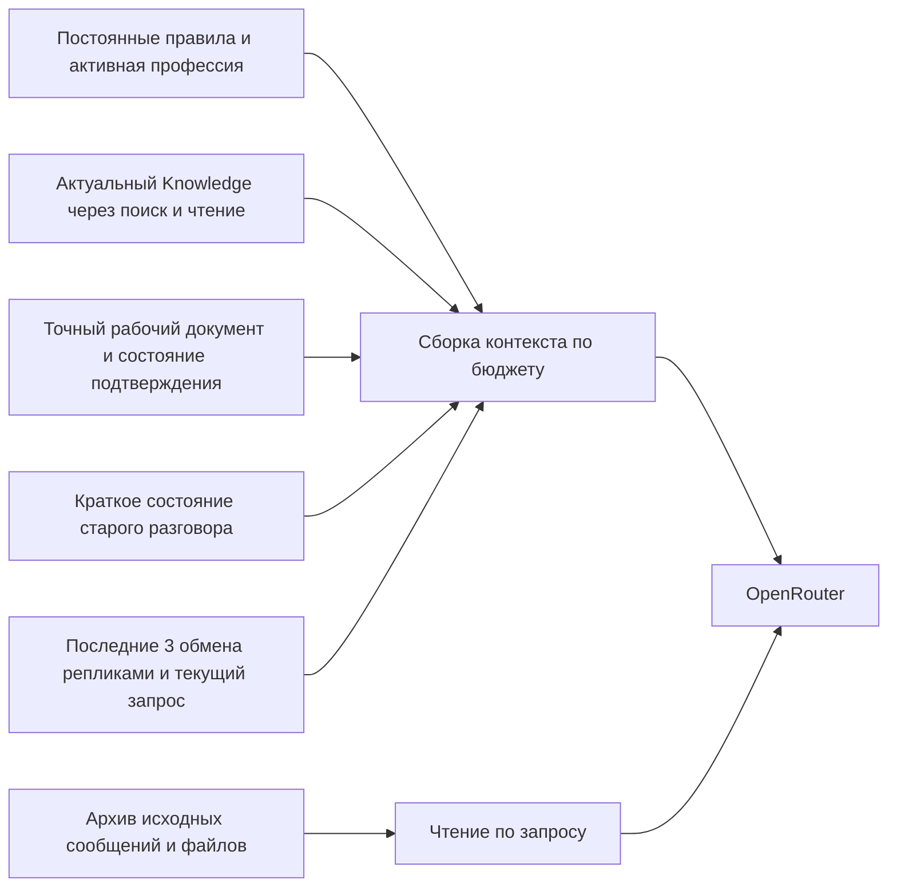

# Контекст AI Chat и стоимость OpenRouter

Для SPS целесообразна сборка контекста из актуального Knowledge, точного рабочего документа, последних трёх обменов репликами и краткого состояния более старого разговора. Её можно встроить в существующий RBAC сервис работы с AI. Перенос исполнения агентов в другой фреймворк для этого не требуется.

Пилотный вопрос на текущем приложении передал основной модели 57 598 входных токенов. Отдельный эксперимент с текущим документом целиком и последними шестью сообщениями передал 7 516 токенов. Четыре проверяемых факта сохранились, стоимость одного вызова модели снизилась на 86,1%. Это результат одного вопроса о фактах; качество длинных правок и автоматического сжатия пока требует отдельной проверки.

## Область измерения

Состояние кода — HEAD `1ef78e0433`, ветка `codex/studio-host-models`. Пилот — локальный проект «М2к», документный тред Brief.md. Метрики взяты из `Social Message.metadata.openRouter.billing.calls`, подтверждение ответа — из аутентифицированного браузера, начисления Credits — из журнала OpenRouter.

| Объект                                | ID                                     |
| ------------------------------------- | -------------------------------------- |
| Profile                               | `ce2b37c1-3494-4f18-8de6-f51fbf7de384` |
| Chat                                  | `28f4d0f0-09f4-4dbf-a8a1-96b6fcb44c9a` |
| Thread                                | `e5343a23-3192-4741-90e8-6cd9ce8bd96d` |
| Brief Source                          | `c3bb5e0c-f05f-4e14-9d73-8e1e3f0627cc` |
| Контрольный ответ текущего приложения | `97750f93-4486-44d5-9e3f-53e52907733b` |

До контрольного запроса тред содержал 22 сообщения: 11 пользовательских и 11 ответов. Их текст занимал 56 097 символов. Пять ответов с полными версиями брифа занимали 45 070 символов, около 80,3% текста истории. Последние три полных обмена репликами занимали 15 605 символов.

Source содержит 65 995 символов, из которых 10 782 — текущие человеческие заметки, остальные — описания материалов и общее описание. К моменту проверки `contentHash` совпадал с `indexedContentHash`; предложение в Thread имело статус `applied`. Старые сообщения об ошибках SVG и неподтверждённой индексации описывают предыдущие состояния и не устанавливают текущее состояние Source.

Контрольный запрос добавил два сообщения в тред. Knowledge и его 13 вложений остались без изменений. Исследование не изменяет код приложения, модельную политику или данные репозиторных снимков.

## Измеренный расход

Исторические 11 ответов вызвали OpenRouter 59 раз:

| Назначение                         | Вызовы | Входные токены | Выходные токены | USD во внутреннем расчёте |
| ---------------------------------- | -----: | -------------: | --------------: | ------------------------: |
| Основная генерация GPT 6.1 Sol     |     11 |        466 138 |          10 127 |                  1,266414 |
| Следующие шаги GPT с инструментами |      7 |        392 568 |           8 409 |                  0,177191 |
| JEV rerank Knowledge               |     19 |        151 129 |           2 290 |                  0,006347 |
| JEV classification                 |     11 |         29 779 |           1 935 |                  0,001251 |
| JEV tool selection                 |     11 |         25 301 |             242 |                  0,001063 |
| **Всего**                          | **59** |  **1 064 915** |      **23 003** |              **1,452266** |

1,065 млн входных токенов — сумма всех вызовов с повторной передачей контекста. Она не означает, что один запрос имел контекст такого размера. На GPT приходится 99,4% стоимости этой выборки. JEV читает много токенов, но стоит существенно меньше основной модели.

Все 11 первых вызовов GPT в исторических ответах имели `cached_tokens=0`. Семь продолжений внутри инструментальных циклов суммарно использовали 370 103 кешированных токена. Кеш работает внутри отдельных ответов, а повторное использование между пользовательскими сообщениями в этой выборке отсутствует.

Внутренний `totalUsd` исторической выборки — $1,452266; сумма `usage.cost`, то есть Credits OpenRouter, — $1,437830. В контрольном вызове эти значения также различаются примерно на 1%. Поэтому показатели расходов ниже используют явно названную величину. Внутренний баланс интерфейса пересчитывается из USD: один внутренний токен равен $0,001 с округлением вверх. Он не равен одному входному или выходному токену модели.

Анализ файлов и embeddings выполняются отдельными вызовами Knowledge и не входят целиком в ledger ответов чата. Приведённая сумма не является полным расходом аккаунта или стоимостью загрузки всех файлов.

### Контроль текущего приложения

Запрос проверял цену удалённого сопровождения, цену запуска под ключ, срок достижения цели и наличие подтверждения оплаты всех трёх месяцев за 250 000 ₽.

Основная модель получила 57 598 входных токенов и вернула 124 выходных. Весь ответ включал 10 вызовов: классификацию, семь пакетов rerank, выбор инструментов и одну генерацию. Их суммарный вход — 117 983 токена. Фактических вызовов инструментов внутри GPT цикла не было; `stopReason=final_text`.

Внутренний расчёт всего ответа — $0,14776967, списание — 148 внутренних токенов. На GPT приходится $0,1452335 внутреннего расчёта и $0,143781165 Credits. Ещё один embedding запроса виден в OpenRouter отдельно: 98 токенов, $0,00000098.

Ответ правильно сохранил четыре факта: 250 000 ₽; 5 млн ₽ за полный запуск под ключ; цель в течение года; отсутствие подтверждения, что 250 000 ₽ покрывают все три месяца. У этого вызова нулевые reasoning tokens, поэтому его стоимость объясняется преимущественно входным контекстом.

### Эксперимент с компактным контекстом

Отдельный скрипт использовал существующий OpenRouter wrapper и ту же `openai/gpt-6.1-sol` с `reasoning.effort=high`. В запрос вошли профиль, текущие человеческие заметки Source целиком, шесть последних сообщений целиком, краткое состояние разговора и тот же контрольный вопрос. Старые фотографии и предыдущие сообщения не передавались. Заметки и последние сообщения не сокращались; даже повтор текущего текста документа в недавнем ответе был сохранён.

| Показатель одного вызова GPT | Текущее приложение | Отдельный эксперимент |
| ---------------------------- | -----------------: | --------------------: |
| Входные токены               |             57 598 |                 7 516 |
| Выходные токены              |                124 |                   134 |
| Кешированные токены          |                  0 |                     0 |
| Reasoning tokens             |                  0 |                     0 |
| USD во внутреннем расчёте    |          0,1452335 |             0,0201285 |
| OpenRouter Credits USD       |        0,143781165 |           0,019927215 |
| Проверяемые факты            |             4 из 4 |                4 из 4 |

Снижение входа — 86,95%; стоимости генерации — 86,14%. Сравнение не опирается на попадание в кеш.

Эксперимент не воспроизводит весь маршрут приложения: в нём нет автоматического rerank, схем инструментов и полной инструкции документной профессии. Состояние старого разговора составлено вручную, а Source прочитан заранее. Поэтому это проверка целесообразности компактного контекста и узкой точности, а не измерение готовой реализации или автоматического summarizer. Доля вклада каждого изменения, визуальный recall и поведение при правках этим опытом не установлены.

## Как контекст устроен сейчас

Ссылки ниже относятся к текущему HEAD. Исследование ISSUE-158 полезно для истории billing, но описывает состояние до его реализации; текущий код уже сохраняет usage, cache и денежный расчёт.

| Механизм                                                                                  | Код                                                                                                                                                                                                                                                     |
| ----------------------------------------------------------------------------------------- | ------------------------------------------------------------------------------------------------------------------------------------------------------------------------------------------------------------------------------------------------------- |
| Загрузка всех связей сообщений текущего треда страницами по 100                           | [findThreadMessageIdsInChat](/Users/rogwild/code/singlepagestartup/sps-lite/libs/modules/rbac/models/subject/backend/app/api/src/lib/controller/singlepage/social-module/profile/find-by-id/chat/find-by-id/message/react-by-openrouter.ts:515)         |
| Сборка истории, исключение служебных сообщений, сброс по `/new`, загрузка старых вложений | [execute](/Users/rogwild/code/singlepagestartup/sps-lite/libs/modules/rbac/models/subject/backend/app/api/src/lib/controller/singlepage/social-module/profile/find-by-id/chat/find-by-id/message/react-by-openrouter.ts:779)                            |
| Начальный Knowledge search и rerank                                                       | [resolveOpenRouterKnowledgeContext](/Users/rogwild/code/singlepagestartup/sps-lite/libs/modules/rbac/models/subject/backend/app/api/src/lib/controller/singlepage/social-module/profile/find-by-id/chat/find-by-id/message/react-by-openrouter.ts:2074) |
| История для JEV ограничена восемью сообщениями по 800 символов                            | [toKnowledgeRerankThreadContext](/Users/rogwild/code/singlepagestartup/sps-lite/libs/modules/rbac/models/subject/backend/app/api/src/lib/controller/singlepage/social-module/profile/find-by-id/chat/find-by-id/message/react-by-openrouter.ts:2228)    |
| Точный pending draft в metadata Thread; подтверждение сохраняет его в Source              | [Document service](/Users/rogwild/code/singlepagestartup/sps-lite/libs/modules/rbac/models/subject/backend/app/api/src/lib/service/singlepage/social-module/profile/ai/document.ts:121)                                                                 |
| Добавление pending draft в начало prompt и Knowledge fragments перед историей             | [generation context](/Users/rogwild/code/singlepagestartup/sps-lite/libs/modules/rbac/models/subject/backend/app/api/src/lib/controller/singlepage/social-module/profile/find-by-id/chat/find-by-id/message/react-by-openrouter.ts:1304)                |
| Инструкция Skill добавляется к последнему user message                                    | [attachSkillMessagePrefixToContext](/Users/rogwild/code/singlepagestartup/sps-lite/libs/modules/rbac/models/subject/backend/app/api/src/lib/controller/singlepage/social-module/profile/find-by-id/chat/find-by-id/message/react-by-openrouter.ts:3102) |
| Каждый следующий шаг отправляет накопленный контекст и все разрешённые схемы инструментов | [SocialProfileAiToolLoop](/Users/rogwild/code/singlepagestartup/sps-lite/libs/modules/rbac/models/subject/backend/app/api/src/lib/service/singlepage/social-module/profile/ai/tool-loop.ts:192)                                                         |
| Исходящие параметры OpenRouter и нормализация usage                                       | [OpenRouter wrapper](/Users/rogwild/code/singlepagestartup/sps-lite/libs/shared/third-parties/src/lib/open-router/index.ts:435)                                                                                                                         |
| Полный повтор анализа текущих файлов при rebuild материалов                               | [MaterialService](/Users/rogwild/code/singlepagestartup/sps-lite/libs/modules/knowledge/backend/app/api/src/lib/service/materials.ts:16)                                                                                                                |

Основной текстовый контекст не имеет общего бюджета токенов или автоматического summary. Ограничение по 800 символов действует на JEV, а не на отвечающую модель. Для инструментов есть предел одного результата, число итераций и таймаут, но нет бюджета суммарного входа всех итераций.

Старые пользовательские изображения и файлы повторно входят в историю. Галереи assistant, помеченные `documentProposalFileIds`, уже исключаются из модельного контекста — это полезная действующая оптимизация. Оригиналы пользовательских вложений всё ещё передаются при последующих текстовых вопросах.

В AI Chat поиск Knowledge запускается даже без явного `@knowledge`: сначала до 30 seed chunks с соседями, затем JEV выбирает до 12 фрагментов. Количество кандидатов ограничено, однако общий prompt бюджет не ограничен. Семь rerank пакетов контрольного запроса — наблюдаемый расход на этот этап.

Изменяемые сведения документа, результат подтверждения и retrieval стоят перед историей. Это объяснимый по коду кандидат на причину cache miss между сообщениями; точное распределение вклада порядка prompt, интервалов и провайдера требует отдельного опыта. Wrapper не передаёт `session_id` или параметры явных cache boundaries.

## Подходы и применимость

В опубликованном описании Claude Code Anthropic использует compaction, сохраняющую решения и незавершённую работу, вместе с внешними заметками. Это подтверждает практическое применение сочетания summary и сохраняемого состояния; такая схема сама по себе не гарантирует сохранение любого старого факта. [Anthropic context engineering](https://www.anthropic.com/engineering/effective-context-engineering-for-ai-agents).

| Подход                                             | Применимость к SPS                                                                                                                                                                                                                                                                                                                                        |
| -------------------------------------------------- | --------------------------------------------------------------------------------------------------------------------------------------------------------------------------------------------------------------------------------------------------------------------------------------------------------------------------------------------------------- |
| Собственный context service в существующем RBAC AI | Рекомендуемый первый шаг. Уже существуют история, Source, exact proposal и scoped retrieval; нужно управлять тем, что из них попадёт в запрос.                                                                                                                                                                                                            |
| LangChain JS `summarizationMiddleware`             | Готовый механизм с token trigger и сохраняемым хвостом сообщений. Имеет смысл при переходе orchestration на LangChain; отдельные правила документов и доступа всё равно останутся у SPS. [Документация](https://docs.langchain.com/oss/javascript/langchain/short-term-memory).                                                                           |
| Mem0                                               | Извлекает факты из диалога и позволяет искать память. Для SPS потребует ещё одного хранилища фактов и правил их соответствия подтверждённому Knowledge; точный документ всё равно нужно хранить отдельно. Сейчас такой дополнительный контур не оправдан измеренным случаем. [Mem0 Add Memory](https://docs.mem0.ai/core-concepts/memory-operations/add). |
| Letta                                              | Предоставляет самостоятельную среду stateful agents и память. Переход затронет исполнение агентов, а текущая задача решается внутри существующего маршрута. [Letta memory](https://docs.letta.com/configuration/memory).                                                                                                                                  |
| OpenRouter context compression                     | Удаляет или обрезает середину prompt при превышении context window. Не задаёт экономический бюджет 10–15 тысяч токенов и не знает, какой draft должен сохраниться точно. Для основного механизма SPS не подходит. [Message Transforms](https://openrouter.ai/docs/guides/features/message-transforms).                                                    |
| Prompt caching                                     | Дополняет сокращение контекста. Требует стабильного повторяемого начала prompt; `session_id` помогает сохранять provider stickiness и объединять вызовы в Logs. Содержимое переписки всё равно передаётся. [OpenRouter Prompt Caching](https://openrouter.ai/docs/guides/best-practices/prompt-caching).                                                  |

## Предлагаемая сборка для SPS

Knowledge остаётся источником сохранённых бизнес-фактов. При ответе на вопрос достаточно подходящих фрагментов; при правке нужны все относящиеся к ней страницы человеческих заметок и актуальный hash. Подтверждённая версия Source имеет приоритет перед старым summary. Ошибка индексации не должна делать сохранённый документ недоступным для прямого scoped read.

Последние три завершённых обмена пользователь–assistant и новый запрос сохраняются точно. Количество сообщений не заменяет token budget: в одной реплике может находиться большой документ. Идентичный draft, встречающийся одновременно в metadata и сообщении, передаётся один раз с явной ссылкой на него из соответствующей реплики.

Рабочий документ хранится точно, отдельно от summary. Для предложений сохранения уже подходит `rbacAiDocumentProposal`: его `userContext`, `fileIds`, hash и статус нельзя восстанавливать из пересказа. Для документа, который пока только обсуждается и не создан как proposal, потребуется отдельное состояние рабочего draft в Thread. Оно не публикуется в Knowledge и не означает подтверждения пользователя. Пока точное состояние такого draft не сохранено, сообщение с ним остаётся закреплённым в контексте.

Summary содержит текущую задачу, утверждения пользователя, ограничения, неизвестные данные, поправки, незавершённые вопросы и ссылки на исходные message IDs. Числа, имена, цены, валюты, даты и статусы сохраняются точно. Предложение assistant, гипотеза и подтверждённый факт имеют отдельные статусы. Например, срок стройки три месяца не превращается в подтверждение цены сопровождения за этот период.

Состояние хранит версию схемы, границу обработанных сообщений и hash входного снимка. Публикация проверяет, что история и предыдущее состояние не изменились; параллельный ответ не может перезаписать более новое summary. Редактирование исходных сообщений и `/new` требуют пересборки или сброса соответствующего состояния. Ссылки на Knowledge включают Source hash, чтобы изменение сохранённых фактов не оставляло старую память в силе.

Исходные сообщения сохраняются в Social. Нужен scoped инструмент чтения старых реплик по ID и поиска в текущем треде, когда краткого состояния недостаточно. Итоговое summary не переносится автоматически в Knowledge. Поиск истории и материалов проверяет Profile, Chat и Thread; пустой scope остаётся пустым.

Старые изображения заменяются в обычных текстовых вопросах именами, ID и доступными описаниями. При визуальном сравнении, отсутствии достаточного описания или прямом обращении к изображению модель получает оригинал. Непроанализированный файл остаётся доступным; отсутствие описания нельзя трактовать как отсутствие содержимого. Такая замена не должна запускать повторный анализ файлов на каждом сообщении.

### Начальные параметры пилота

Значения ниже — исходные настройки для проверки, а не измеренные оптимумы:

- Последние три обмена репликами и новый запрос — без смыслового сжатия.
- Summary старого разговора — ориентир до 1 000 токенов.
- Обновление summary — при накоплении около 8 000 токенов несжатой старой истории, по watermark обработанных сообщений, а не на каждой реплике.
- Обычный текстовый запрос — ориентир 12 000 входных токенов, включая инструкции и схемы инструментов.
- Knowledge excerpts — ориентир 3 000 токенов внутри общего бюджета.
- Точный draft и необходимые страницы правки имеют приоритет. Большая правка получает увеличенный бюджет или выполняется по разделам; её нельзя молча обрезать до обычного лимита.

Для русского текста и multimodal input бюджет нельзя считать только существующей оценкой `words × 1.3`. Нужна проверенная токенизация для выбранной модели, учёт развёрнутого текста файлов и стоимости изображений. Provider usage остаётся фактом после выполнения запроса; предварительная оценка должна калиброваться по нему.

Постоянные правила, профессия и стабильные схемы инструментов располагаются в начале prompt. Изменяемые retrieval, состояние документа и текущий вопрос — ближе к концу. `session_id` связывается со scope треда и отвечающим профилем. Кеш не заменяет корректный сбор контекста.

## Порядок внедрения и проверка качества

1. Добавить наблюдаемость сборки: токены инструкций, истории, draft, Knowledge, файлов и схем инструментов; число вызовов; cached/write/reasoning tokens; Credits и внутренний USD. Отдельно учитывать ingestion файлов. Полные private prompt не нужны в обычных логах.
2. Устранить повторную передачу старых визуальных оригиналов и заменённых полных документов с сохранением точного draft и доступа к архиву. Стабилизировать начало prompt и связать вызовы session ID.
3. Добавить версионированное краткое состояние Thread и инкрементальное обновление по watermark. Для первого пилота сохранить модельную политику; более дешёвый summarizer оценивать отдельным опытом.
4. Включить сборку по token budget и сокращение завершённых tool results внутри длинного цикла. Цепочки `assistant.tool_calls` и соответствующих `tool` ответов сохранять валидными; результаты незавершённых действий не удалять. Нужен бюджет суммарного расхода цикла, а не только максимальные 50 итераций.
5. Выполнить replay выборки и включить механизм сначала для пилотного Profile. Сохранять возможность возврата к полной истории при ошибке сборки или недостаточном recall.

Новый сервис относится к существующему каталогу `libs/modules/rbac/models/subject/backend/app/api/src/lib/service/singlepage/social-module/profile/ai/`, рядом с `document.ts`, `jev.ts` и `tool-loop.ts`. Типизированный namespace состояния может использовать существующий JSONB Thread metadata. Постоянная память бизнеса остаётся в Knowledge; новый shared package или второй модуль памяти для первого этапа не требуется.

Приёмочная выборка должна включать длинные обсуждения с поправками и сменой темы, неподтверждённый draft за пределами последних трёх обменов, отклонённое предложение, подтверждение точного текста, Source с изменённым hash, незавершённую индексацию, визуальный follow-up и попытку чтения чужого scope. Подтверждение обязано сохранять точный staged текст; никаких новых сохранений из summary.

Ориентир принятия пилота — отсутствие ошибок по этим критическим случаям, сохранение последних реплик и точного draft, минимум 50% снижения медианной полной стоимости на репрезентативных длинных тредах с включённой ценой summarizer. Порог является предложенным условием приёмки. Один успешный вопрос не подтверждает достижение этого условия.

Экономику нужно считать как `стоимость ответов + стоимость обновлений summary + embeddings + анализ файлов`. Summary окупается, когда его стоимость меньше суммарной экономии последующих ответов до следующего обновления. Для длинных документов выходные токены полного нового draft останутся существенной частью цены. Передача только изменённого раздела с точным серверным применением может быть следующим этапом после проверки сохранности документов.

В этой ветке есть достаточные механизмы для первого этапа. Измеренная экономия оправдывает пилот собственного context service; внедрение новой среды памяти пока не имеет подтверждённого преимущества над использованием существующих Social и Knowledge.
